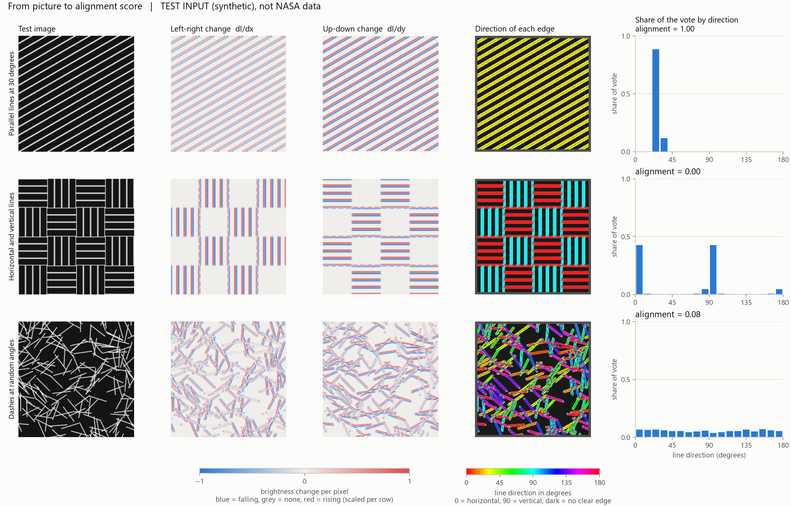
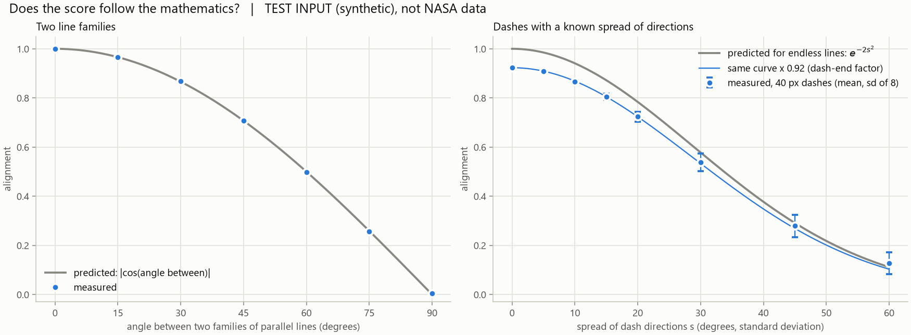
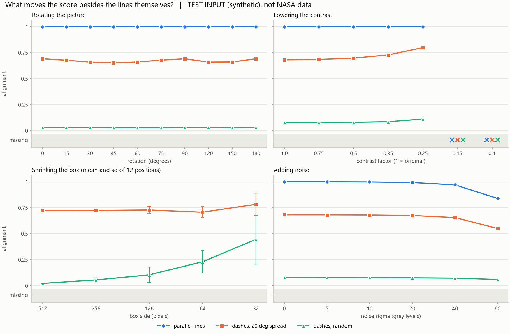
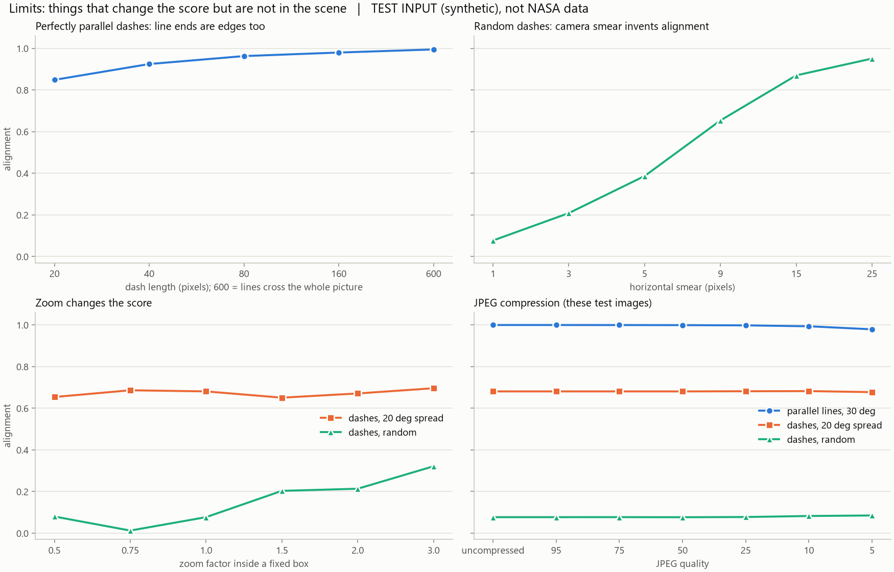
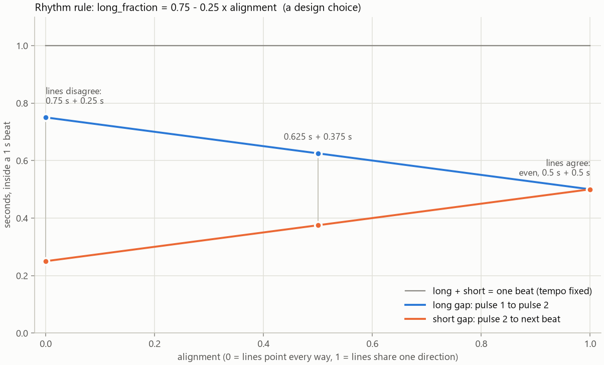
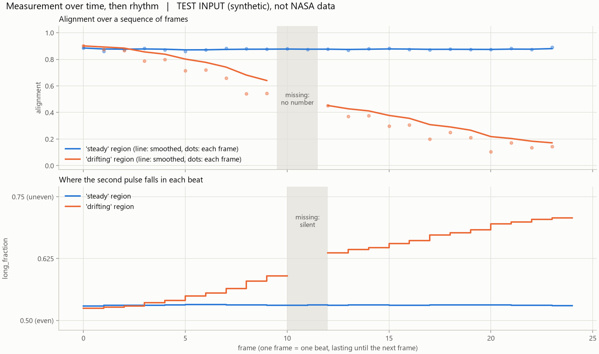
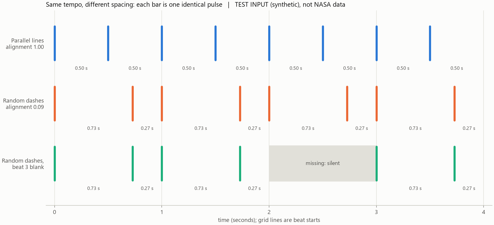

# Math notes: from a rendered picture to a rhythm

Owner: Developer A. Companion to `mapping_spec.md` (the one-page rule) and `science_review.md`
(expected and observed results). Code: `analysis/sonata_math/`.

Tags used below, as `CONTRIBUTING.md` asks:
**Verified** = measured by our tests on synthetic TEST INPUTS, with the table named;
**Design choice** = something we decided; **Unverified** = reasoning not yet checked on NASA frames.
Nothing in this document has been measured on NASA imagery yet.

## Summary

For one box of one frame the engine does this:

1. Turn colour into one brightness number per pixel.
2. Estimate how fast brightness changes left–right and up–down (the gradient).
3. Keep pixels that the mask allows and that sit on a clear edge.
4. Add up the gradient products into a 2×2 matrix (the structure tensor).
5. Report `alignment` = how lopsided that matrix is, from 0 to 1, or `missing` with a reason.
6. Place the second pulse of each beat at `long_fraction = 0.75 − 0.25 × alignment`.

It measures **lines in a drawing**. It does not measure water speed, turbulence or ocean health.

## 1. What a rendered visualization can tell us

Between the ocean and our pixels there is a chain of choices we do not control:

ocean → ECCO2 model → surface-current fields → flow lines (where they start, how long they are,
how bright) → colour map → map projection → rendering → file encoding → pixels.

**What we can legitimately extract** is geometry and brightness of the *picture*: where
brightness changes, in which direction it changes, and how consistent those directions are inside
a box. We can compare two boxes of the same frame, and the same box across frames.

**What we cannot extract** without the model data itself: speed, energy, temperature values, or
anything about ocean health. A flow line is drawn along the modelled current, so line directions
are *related* to current directions. But the number we compute also depends on how lines were
seeded and drawn. Three examples that matter for SVS 3912:

- **Line length.** Short dashes score lower than long lines even when perfectly parallel
  (section 5). If the renderer draws longer lines where flow is faster, our number partly reflects
  line length. *Unverified for this source.*
- **Map projection.** The frames are equirectangular (source manifest). East–west distances are
  stretched by $1/\cos(\text{latitude})$ relative to north–south. A direction at true angle $\theta$
  from east is drawn at $\theta'$ with $\tan\theta' = \tan\theta \cdot \cos(\text{latitude})$. At 60°
  latitude a 45° line is drawn at 27°. Every direction is squeezed toward horizontal, which
  *raises* alignment at high latitude for the same flow. *Unverified on frames; follows from the
  projection.* Choose the two regions at similar latitudes, or say this out loud.
- **Colour.** Line colour encodes modelled temperature. A brightness formula that favours some
  hues would make our number depend on temperature (section 2).

## 2. Brightness and gradients

**Grayscale.** We use $I = \max(R, G, B)$ ("value"). **Design choice.** The usual weighted sum
(luma $= 0.299R + 0.587G + 0.114B$) makes a pure blue line 8× fainter than a yellow one, so cold
water would look like it has fewer lines. **Verified** (`science_review.md`, colour table): the
same drawing in white, yellow, green, red or blue gives the same result with "value"; with luma,
blue lines become `missing`.

**Gradient.** Treat the image as a surface $I(x, y)$. Its gradient

$$\nabla I = \left(\frac{\partial I}{\partial x},\ \frac{\partial I}{\partial y}\right)$$

points toward increasing brightness, and its length $m = \lVert\nabla I\rVert$ is the brightness
change per pixel in that direction. The change along any unit direction $u$ is $\nabla I \cdot u$.
Along a line brightness does not change, so $\nabla I \cdot u = 0$ there: **the gradient is at
right angles to the line.** That is why edges reveal line direction.

One more fact drives the rest of the design. A bright line has two sides. On one side brightness
rises, on the other it falls, so the two gradients point in *opposite* directions. Whatever we do
next must treat $\nabla I$ and $-\nabla I$ as the same vote.

## 3. How Sobel filters approximate the derivatives

Pixels are samples one unit apart. From the Taylor series,

$$\frac{I(x+1) - I(x-1)}{2} = \frac{\partial I}{\partial x} + \frac{1}{6}\frac{\partial^3 I}{\partial x^3} + \dots$$

so the *central difference* estimates the derivative with an error that is small when brightness
varies slowly. Differencing amplifies pixel noise, so Sobel averages the central difference over
three neighbouring rows with weights 1, 2, 1:

$$S_x = \frac{1}{8}\begin{bmatrix} -1 & 0 & 1 \\ -2 & 0 & 2 \\ -1 & 0 & 1 \end{bmatrix}
= \frac{1}{4}\begin{bmatrix} 1 \\ 2 \\ 1 \end{bmatrix} \cdot \frac{1}{2}\begin{bmatrix} -1 & 0 & 1 \end{bmatrix}$$

and $S_y$ is its transpose. Dividing by 8 makes the answer a true slope: a ramp rising 3 grey
levels per pixel gives exactly 3. **Verified** (`test_sobel_returns_the_slope_in_grey_levels_per_pixel`).
So `gradient_threshold = 12` means "12 grey levels per pixel on a 0–255 scale".

Why each step is needed:

| Step | Why |
| --- | --- |
| Gaussian blur, $\sigma = 1$ px, before Sobel | A 1-pixel line is not smooth enough to differentiate, and single-pixel noise would dominate. Blur sets the scale we measure at. **Design choice.** Without it, noise of $\sigma = 20$ alone is accepted as lines; with it, it is `missing`. |
| Central difference | Estimates the slope without shifting the edge by half a pixel. |
| 1-2-1 averaging | Cuts noise in the derivative. |
| Divide by 8 | Gives units we can state: grey levels per pixel. |

Limits of Sobel: it underestimates very fine detail, and slightly differently in different
directions. **Verified:** parallel test lines at 15° are reported at 14.3° (under 1° error), and
the score of the same dash pattern varies by about ±0.02 with its orientation on the pixel grid
(rotation table, lowest near 45°).

## 4. The structure tensor

We cannot average gradient vectors: the two sides of every line cancel and the average is zero.
Instead average the *outer product* $\nabla I\,\nabla I^{\mathsf T}$, which is the same for
$\nabla I$ and $-\nabla I$. Summed over the pixels $V$ that vote:

$$J = \sum_{p \in V} \nabla I_p \nabla I_p^{\mathsf T}
= \begin{bmatrix} J_{xx} & J_{xy} \\ J_{xy} & J_{yy} \end{bmatrix},\qquad
J_{xx} = \sum g_x^2,\quad J_{yy} = \sum g_y^2,\quad J_{xy} = \sum g_x g_y$$

Its meaning: for any unit direction $u$,

$$u^{\mathsf T} J u = \sum_{p \in V} (\nabla I_p \cdot u)^2$$

is the total squared brightness change along $u$. $J$ is symmetric and never negative, so it has
eigenvalues $\lambda_1 \ge \lambda_2 \ge 0$:

$$\lambda_{1,2} = \frac{J_{xx} + J_{yy}}{2} \pm \frac{1}{2}\sqrt{(J_{xx} - J_{yy})^2 + 4J_{xy}^2}$$

$\lambda_1$ is the change along the direction where brightness changes most (across the lines);
$\lambda_2$ is the change along the direction where it changes least (along the lines).

| Picture in the box | Eigenvalues |
| --- | --- |
| Lines share one direction | $\lambda_1 \gg \lambda_2 \approx 0$ |
| Lines in many directions | $\lambda_1 \approx \lambda_2 > 0$ |
| Nothing there | $\lambda_1 \approx \lambda_2 \approx 0$ |

The dominant gradient axis is $\tfrac12\,\mathrm{atan2}(2J_{xy},\ J_{xx} - J_{yy})$; the lines run
at right angles to it. The engine reports this as `dominant_angle_deg` (0 = horizontal, 90 =
vertical, counter-clockwise on screen). It is meaningless when alignment is near 0.

## 5. The alignment score

$$C = \frac{\lambda_1 - \lambda_2}{\lambda_1 + \lambda_2}
= \frac{\sqrt{(J_{xx} - J_{yy})^2 + 4J_{xy}^2}}{J_{xx} + J_{yy} + \varepsilon}$$

The second form follows directly from the eigenvalue formula: the difference is the square root
term and the sum is the trace. **Verified** (`test_coherence_is_the_eigenvalue_contrast_of_the_structure_tensor`).

Properties, each of which we need:

- **Between 0 and 1**, because $J_{xy}^2 \le J_{xx}J_{yy}$.
- **Unchanged by rotation**: eigenvalues do not depend on the coordinate axes.
- **Unchanged by reversing** the picture or by which side of a line is brighter.
- **Unchanged by scaling contrast**: numerator and denominator scale together. (The fixed
  threshold breaks this near the threshold; see limitation 5.)

**It is the same vote as in the mapping spec.** Write each gradient as
$m(\cos\varphi, \sin\varphi)$. Then $g_x^2 - g_y^2 = m^2\cos 2\varphi$ and
$2 g_x g_y = m^2 \sin 2\varphi$, so

$$C = \frac{\left|\sum m^2 e^{2i\varphi}\right|}{\sum m^2}$$

Every voting pixel contributes an arrow at *twice* its angle (so opposite gradients agree), with
length $m^2$. Add the arrows tip to tail and divide by the total length. The spec's first draft
used length $m$; the structure tensor uses $m^2$. **Verified** for both
(`test_coherence_is_a_doubled_angle_vote`). They rank test pictures the same way and differ by
about 0.04 at most (weighting table). We use $m^2$: it is the standard definition, it has the closed-form
predictions below, and it is less affected by faint dash ends. **Design choice.**
(Some textbooks call $C^2$ the coherence. Ours is not squared.)

**Predictions we checked.** All **Verified** in `science_review.md`:

| Situation | Predicted | Observed |
| --- | --- | --- |
| Two equal families of parallel lines, $\delta$ apart | $\lvert\cos\delta\rvert$ | within 0.005 for $\delta$ = 0…90° |
| Fraction $f$ of the energy in one direction, rest at 90° | $\lvert 2f - 1\rvert$ | within 0.005 |
| Line angles normally spread, standard deviation $s$ rad | $k\,e^{-2s^2}$ | ratio to $s{=}0$ within 0.006 up to $s$ = 30° |
| $n$ lines at random | about $0.886/\sqrt{n}$, not 0 | 0.065 observed, 0.067 predicted |
| Noise $\sigma$ on stripes with energy $E$ over $N$ pixels | $E/(E + 2N\tfrac{12}{64}\sigma^2)$ | within 0.001 |

### Is this metric suitable for our visualization?

**Yes, for one statement only:** "inside this box, the visible lines mostly share one direction"
(high) or "they point different ways" (low). It is standard, deterministic, cheap, and behaves as
the mathematics predicts on every test we ran.

**Its limitations** (evidence in `science_review.md`):

1. **It is a whole-box number.** Two perfectly organised families at 90° score 0, the same as
   chaos. A closed swirl also scores near 0, because its edges point every way. Low alignment is
   not "disorder" and not "turbulence".
2. **Any edge votes.** Coastlines, labels, the colour bar and mask seams are lines too. A fake
   legend moved a test score from 0.65 to 0.57 until it was masked.
3. **Dash ends vote sideways.** Perfectly parallel dashes score 0.85 (20 px), 0.92 (40 px), 0.96
   (80 px), 0.99 (lines crossing the whole picture). On real frames the score will top out below 1.
4. **Small boxes inflate the score.** Random dashes average 0.02 in a 512 px box, 0.10 at 128 px,
   0.23 at 64 px, 0.44 at 32 px. Regions must be large and **the same size**.
5. **Line brightness matters near the threshold.** Dimming a test picture to 25% contrast moved
   its score from 0.68 to 0.80 before it went `missing`.
6. **Orientation on the pixel grid** shifts the score by about ±0.02.
7. **Map projection** squeezes directions toward horizontal at high latitude (section 1). *Unverified.*
8. **Camera motion and zoom are not allowed.** A 3-pixel smear raised random dashes from 0.08 to
   0.21; 9 pixels gave 0.65. Zoom changed the same picture between 0.01 and 0.32.
9. **Strong noise or fine texture** passes for lines pointing every way (noise $\sigma$ = 40 on a
   blank image reads 0.03, `ok`).
10. **Bright lines dominate**, because the weight is $m^2$.

## 6. Low alignment versus not enough information

$C$ is a ratio, so it forgets *how much* evidence it was built from. A blank box gives $0/0$. With
$\varepsilon$ in the denominator that evaluates to 0, which would be read as "the lines disagree".
That is the wrong statement. So we keep a second number that measures the amount of evidence:

$$\text{usable fraction} = \frac{\text{pixels allowed by the mask with } m \ge \tau}{\text{all pixels in the box}}$$

and decide before computing $C$:

| Condition | Result |
| --- | --- |
| Mask excludes every pixel | `missing`, `all_masked` |
| Usable fraction below `min_usable_fraction` (5%) | `missing`, `too_few_edges` |
| Frame file absent or unreadable | `missing`, `frame_unreadable` |
| Otherwise | `ok`, alignment in [0, 1] |

$\varepsilon$ only guards the division. It never decides anything. A missing value is `null` with a
sentence explaining why, never 0. **Verified**: blank, masked, low-contrast and unreadable inputs
all give `missing` (named cases table; `test_our_checker_refuses_a_zero_for_missing_data`).

What this rule cannot separate: strong isotropic texture from genuinely mixed lines (limitation
9), and "few lines that happen to agree" from "many lines that agree" (limitation 4).

## 7. Masks, crops, legends, camera movement, compression

**Masks.** A gradient at one pixel is computed from its neighbours: 4 pixels of blur plus 1 of
Sobel. A pixel may vote only if all pixels within 5 of it are inside the box and included by the
mask. So an excluded label cannot leak into the result. **Verified exactly**: replacing the
excluded pixels with random values leaves the result bit-for-bit identical. A mask file that is
named but absent stops the run; it does not fall back to "no mask".

**Crops.** The result belongs to the pair (picture, box). The same checkerboard scores 0.00 as a
whole and ≥ 0.95 for a single tile. Guidance for choosing regions: equal size, at least ~128 px on
the short side, similar latitude, no coast or label inside unless masked.

**Legends, camera, compression.** See limitations 2 and 8. JPEG changed our test images by at
most 0.001 at quality 50 and 0.02 at quality 5, and never turned a blank image into a measurement.
That is on synthetic line art; real frames with fine colour detail are **Unverified**. Use the
downloadable frame set, not a compressed video.

## 8. From alignment to rhythm

**The rule (Design choice).** Each measured step is one beat of length $T$ with two identical
pulses. Pulse 1 starts the beat. Pulse 2 falls at $L \cdot T$, where

$$L(A) = 0.75 - 0.25\,A$$

So the two gaps are $d_\text{long} = T\,L$ and $d_\text{short} = T\,(1 - L)$. With $T$ = 1 s this
is exactly the first-draft pair $d_1 = 0.25 + 0.25C$ (the short gap) and $d_2 = 1 - d_1$ (the long
gap). **Verified** (`test_rule_equals_the_first_draft_formula_d1_d2`).

Why it meets each requirement:

- **Fixed average tempo.** $d_\text{long} + d_\text{short} = T$ for every $A$. There are always two
  pulses per beat. Only the spacing inside the beat carries data.
- **Predictable.** The rule is a straight line, it changes only at beat boundaries, and it can be
  read backwards: $A = 3 - 4L$. Musically $L$ is a swing ratio: 1:1 (even) at $A = 1$, 2:1
  (triplet swing) at $A = 1/3$, 3:1 (dotted) at $A = 0$.
- **Never ambiguous.** $L$ stays in [0.5, 0.75]: pulse 2 is never before the half-way point and
  never closer than $T/4$ to the next beat, so the pulses cannot merge or swap roles.
- **Fair.** One settings object for all regions; same tempo, pitch, loudness and note length; same
  source moment. From section 5, add: same box size.
- **Missing is silent.** A missing step has no pulses. Smoothing does not carry a value across a
  gap.
- **Separate from the piano.** The engine produces only `earth` notes and reads no user input.

**Order of the two gaps.** The contract defines `long_fraction` as the share of the beat *before*
the second pulse, so each beat is long gap then short gap. The first draft listed the short gap
first. Because all pulses are identical the repeating pattern is the same; only which pulse lands
on the beat line differs. We follow the contract.

**How big is the audible difference?** The second pulse moves $0.25\,T$ across the whole range:
2.5 ms per 0.01 of alignment at $T$ = 1 s. Two regions that differ by 0.2 differ by 50 ms. Whether
listeners can tell a given pair apart is for Student B's listening tasks to establish.
**Unverified.** Given limitations 3 and 4, real regions will probably sit in a narrower band than
0–1. Measure both regions first; if they are close, steepen the rule for both regions equally, then
freeze it.

**Smoothing over time (optional).** $s_k = \alpha a_k + (1 - \alpha) s_{k-1}$ over each unbroken
run of valid steps; $\alpha = 1$ switches it off. It calms frame-to-frame wobble but lags a trend
by roughly $1/\alpha$ frames: in the test sequence the smoothed value is 0.64 when the frame itself
measures 0.54.

## 9. Still to do on real frames

- Calibrate `gradient_threshold` and `min_usable_fraction` on a few real frames, then freeze them.
  The current values (12 and 0.05) are the practice values, not tuned ones.
- Check that the usable fraction is comfortably above 5% and similar in both regions.
- Confirm the frame set has no camera motion, fades or overlays (Student A's land-pixel test).
- Measure the alignment gap between the two chosen regions and decide whether the rule's slope
  needs steepening.

## References

- J. Bigün and G. Granlund, "Optimal orientation detection of linear symmetry", ICCV 1987.
- M. Kass and A. Witkin, "Analyzing oriented patterns", Computer Vision, Graphics, and Image Processing, 1987.
- B. Jähne, *Digital Image Processing*, Springer (structure tensor and coherence measure).
