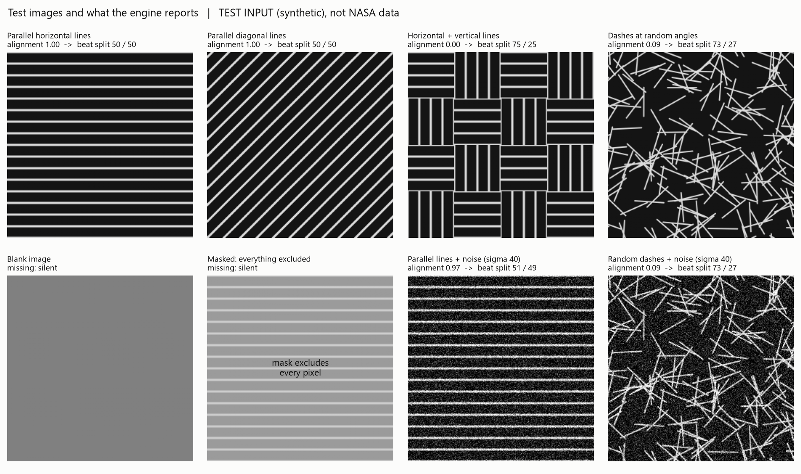
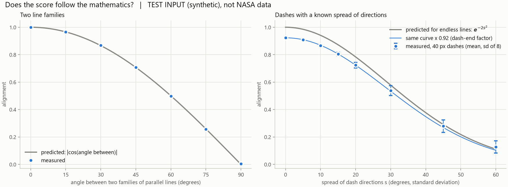
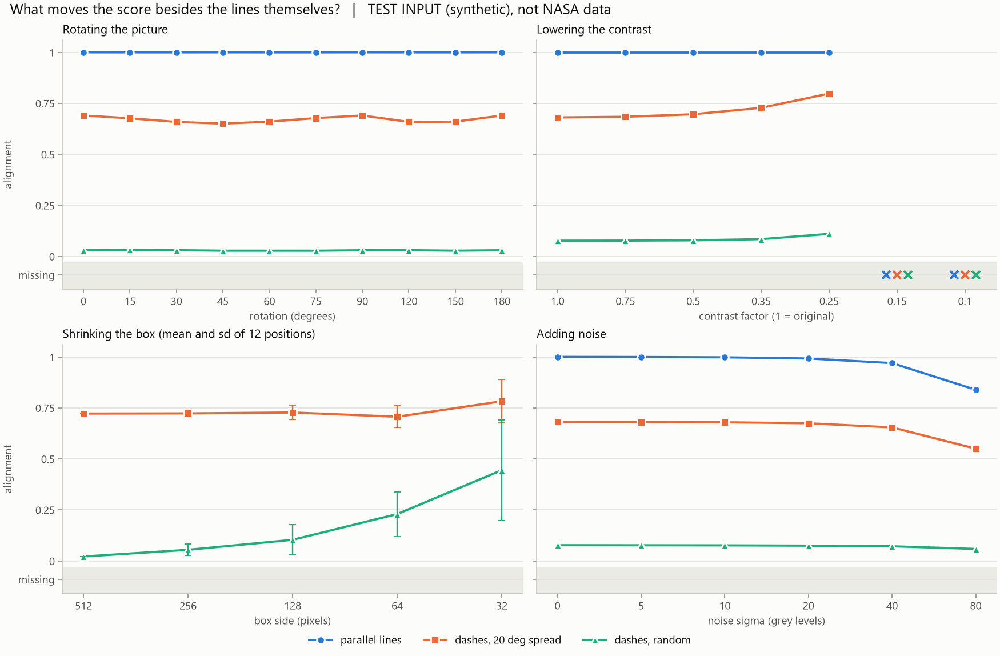
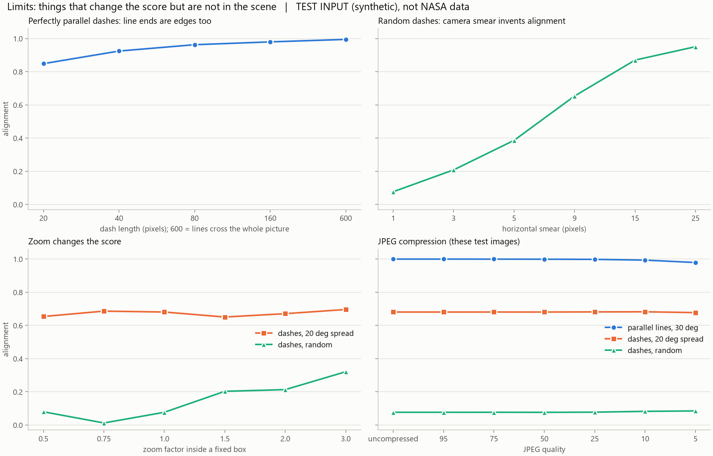
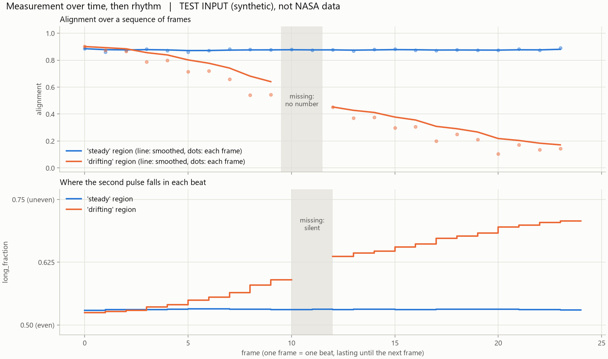

# Science review: expected and observed

Owner: Developer A. This records what the math engine was expected to do and what it did.

**Sections 1 to 7 use TEST INPUTS (synthetic images), not NASA data.** Sections 9 and 10 use NASA
frames: section 9 compares the draft circles, section 10 is the approved pair the app plays. The tables between the
`table:` markers are written by
`analysis/run_experiments.py` from the numbers it just measured; do not edit them by hand. Re-run
that script after changing any setting.

<!-- table:environment -->
Last run: 2026-11-14 with Python 3.14.7, numpy 2.5.4, OpenCV 5.0.0.
<!-- /table:environment -->

Settings for every table unless it says otherwise: grayscale = max(R, G, B), Gaussian blur σ = 1 px,
Sobel 3×3 ÷ 8, gradient threshold 12 grey levels per pixel, minimum usable fraction 0.05, weight
m², no smoothing. Derivations are in `math_notes.md`.

## Result in brief

- All named cases, including the six in `mapping_spec.md`, behave as expected.
- The score follows the closed-form predictions for two line families, unequal mixes, angular
  spread, chance level and noise.
- `pytest` in `analysis/` passes, and tests fail when the engine is deliberately broken (squared
  score, no mask margin, 0 instead of missing, drifting tempo, smoothing across a gap).
- Ten limitations were found. They are listed in section 6 with their evidence.
- The approved regions, Equatorial Pacific and Kuroshio, measure 0.67 and 0.07 on 30 NASA frames.
  After smoothing the smallest gap in any frame is 0.57, and no frame is `missing` (section 10).
- The Southern Ocean draft was dropped: most of its score comes from the map projection (section 9).

## 1. Named test cases

`long_fraction` is the share of the beat before the second pulse: 0.5 is even, 0.75 is the
strongest long–short.

<!-- table:spec_cases -->
### Named test cases

Expected: See the 'expected' column; the rule is long_fraction = 0.75 - 0.25 * alignment.

| case | expected | status | alignment | reason_code | usable_fraction | long_fraction | agrees |
| --- | --- | --- | --- | --- | --- | --- | --- |
| Aligned: parallel horizontal lines | near 1; even pulses | ok | 1.0 | - | 0.45 | 0.5 | yes |
| Aligned: parallel diagonal lines (45 deg) | near 1; even pulses | ok | 1.0 | - | 0.408 | 0.5 | yes |
| Aligned: parallel short dashes (40 px) | high, below 1: dash ends are edges too | ok | 0.9209 | - | 0.422 | 0.5198 | yes |
| Mixed: horizontal and vertical lines, equal areas | near 0; strong long-short | ok | 0.0 | - | 0.474 | 0.75 | yes |
| Mixed: dashes at random angles | near 0 (about 0.89/sqrt(n)); strong long-short | ok | 0.0892 | - | 0.422 | 0.7277 | yes |
| Reversed: parallel lines turned 180 deg | same as aligned (1.0000) | ok | 1.0 | - | 0.45 | 0.5 | yes |
| Blank image | missing with a reason; no pulses | missing | missing | too_few_edges | 0.0 | missing | yes |
| Masked: everything excluded | missing with a reason; no pulses | missing | missing | all_masked | 0.0 | missing | yes |
| Masked: right half excluded | same as aligned; fewer pixels vote | ok | 1.0 | - | 0.216 | 0.5 | yes |
| Repeated: same image again | identical (1.0000) | ok | 1.0 | - | 0.45 | 0.5 | yes |
| Noise added to parallel lines (sigma 20) | slightly below 1 | ok | 0.9921 | - | 0.449 | 0.502 | yes |
| Noise added to random dashes (sigma 20) | still near 0 | ok | 0.0903 | - | 0.424 | 0.7274 | yes |
| Noise only (sigma 20), no lines | missing: noise is below the edge threshold | missing | missing | too_few_edges | 0.0 | missing | yes |
<!-- /table:spec_cases -->

## 2. Does the score follow the mathematics?

<!-- table:two_families -->
### Two equal families of parallel lines, delta degrees apart

Expected: alignment = |cos(delta)|

| delta_deg | predicted | observed | difference |
| --- | --- | --- | --- |
| 0 | 1.0 | 1.0 | 0.0 |
| 15 | 0.9659 | 0.9666 | 0.0007 |
| 30 | 0.866 | 0.8674 | 0.0014 |
| 45 | 0.7071 | 0.7071 | 0.0 |
| 60 | 0.5 | 0.4976 | -0.0024 |
| 75 | 0.2588 | 0.2562 | -0.0026 |
| 90 | 0.0 | 0.005 | 0.005 |
<!-- /table:two_families -->

<!-- table:energy_share -->
### Horizontal lines above, vertical lines below, in unequal shares

Expected: alignment = |2f - 1|, where f is the horizontal share of the voting area

| share of rows | f (voting area) | predicted | observed | difference |
| --- | --- | --- | --- | --- |
| 0.5 | 0.5 | 0.0 | 0.005 | 0.005 |
| 0.6 | 0.6091 | 0.2182 | 0.215 | -0.0032 |
| 0.75 | 0.7727 | 0.5455 | 0.5483 | 0.0028 |
| 0.9 | 0.9364 | 0.8727 | 0.8725 | -0.0002 |
<!-- /table:energy_share -->

<!-- table:spread_law -->
### 40 px dashes whose angles are normally spread (mean of 8 images)

Expected: alignment = k * exp(-2 s^2), s in radians; k < 1 is the dash-end factor, so observed / observed(s=0) should equal exp(-2 s^2)

| spread_deg | exp(-2s^2) | observed_mean | observed_sd | observed / observed(0) |
| --- | --- | --- | --- | --- |
| 0 | 1.0 | 0.923 | 0.0029 | 1.0 |
| 5 | 0.9849 | 0.9089 | 0.0031 | 0.9847 |
| 10 | 0.9409 | 0.8672 | 0.0074 | 0.9395 |
| 15 | 0.8719 | 0.8041 | 0.0125 | 0.8712 |
| 20 | 0.7837 | 0.7241 | 0.0201 | 0.7845 |
| 30 | 0.5779 | 0.5386 | 0.0361 | 0.5835 |
| 45 | 0.2912 | 0.2789 | 0.0459 | 0.3022 |
| 60 | 0.1116 | 0.1266 | 0.0443 | 0.1372 |
<!-- /table:spread_law -->

The observed mean at 45° and 60° sits above the prediction. That is the chance level of a finite
number of dashes (next table), not a failure of the formula.

<!-- table:random_floor -->
### Random dashes: how far from 0 does chance leave the score?

Expected: mean about 0.886 / sqrt(n) for n independent dashes (about 174 in view here)

| images | observed_mean | observed_sd | observed_max | 0.886/sqrt(n) |
| --- | --- | --- | --- | --- |
| 30 | 0.0652 | 0.0348 | 0.1326 | 0.0672 |
<!-- /table:random_floor -->

<!-- table:noise_formula -->
### Noise on smooth stripes, threshold and blur switched off

Expected: alignment = E / (E + 2 N (12/64) sigma^2)

| noise_sigma | predicted | observed | difference |
| --- | --- | --- | --- |
| 2 | 0.9944 | 0.9944 | 0.0 |
| 5 | 0.966 | 0.9661 | 0.0001 |
| 10 | 0.8765 | 0.8768 | 0.0003 |
| 20 | 0.6395 | 0.6401 | 0.0007 |
| 40 | 0.3072 | 0.3071 | -0.0001 |
<!-- /table:noise_formula -->

## 3. Rotation, contrast, cropping, noise

<!-- table:rotation -->
### Rotating the picture (resampled, measured inside a disc)

Expected: unchanged: the score depends on eigenvalues, which rotation does not alter. The last column redraws dashes at each angle instead of resampling (mean of 6).

| rotation_deg | parallel lines | dashes, 20 deg spread | dashes, random | redrawn 20 deg spread |
| --- | --- | --- | --- | --- |
| 0 | 1.0 | 0.6906 | 0.0303 | 0.7123 |
| 15 | 0.9998 | 0.6769 | 0.0319 | 0.7048 |
| 30 | 0.9998 | 0.6592 | 0.0306 | 0.6822 |
| 45 | 1.0 | 0.6506 | 0.0281 | 0.6732 |
| 60 | 0.9998 | 0.6604 | 0.0281 | 0.6839 |
| 75 | 0.9998 | 0.6779 | 0.028 | 0.7037 |
| 90 | 1.0 | 0.6906 | 0.0303 | 0.7129 |
| 120 | 0.9998 | 0.6592 | 0.0306 | 0.6856 |
| 150 | 0.9998 | 0.6604 | 0.0281 | 0.6808 |
| 180 | 1.0 | 0.6906 | 0.0303 | 0.7123 |
<!-- /table:rotation -->

The dashes score lowest near 45° whether the picture is resampled or redrawn, so the dip is a
property of measuring on a pixel grid, not of the resampling. We did not isolate whether Sobel or
the line drawing causes it.

<!-- table:contrast -->
### Scaling the contrast (1.0 = lines 200 grey levels above the background)

Expected: unchanged while edges are well above the threshold; missing (never 0) once they are not

| contrast_factor | parallel lines | usable (parallel lines) | dashes, 20 deg spread | usable (dashes, 20 deg spread) | dashes, random | usable (dashes, random) |
| --- | --- | --- | --- | --- | --- | --- |
| 1.0 | 1.0 | 0.45 | 0.681 | 0.465 | 0.0771 | 0.457 |
| 0.75 | 1.0 | 0.45 | 0.6842 | 0.423 | 0.0775 | 0.416 |
| 0.5 | 1.0 | 0.338 | 0.6966 | 0.34 | 0.0789 | 0.335 |
| 0.35 | 1.0 | 0.225 | 0.7281 | 0.236 | 0.0846 | 0.236 |
| 0.25 | 1.0 | 0.113 | 0.7977 | 0.091 | 0.1105 | 0.077 |
| 0.15 | missing | 0.0 | missing | 0.0 | missing | 0.0 |
| 0.1 | missing | 0.0 | missing | 0.0 | missing | 0.0 |
<!-- /table:contrast -->

<!-- table:crop -->
### Crop size: 12 boxes at random positions in one large field of dashes

Expected: same mean for a uniform field, but more scatter and an upward drift for small boxes (fewer independent dashes leave a larger chance vote)

| box_px | 20 deg spread mean | sd | missing | random mean | sd  | missing  |
| --- | --- | --- | --- | --- | --- | --- |
| 512 | 0.7221 | 0.0 | 0 | 0.0217 | 0.0 | 0 |
| 256 | 0.723 | 0.0123 | 0 | 0.0545 | 0.0273 | 0 |
| 128 | 0.7275 | 0.0348 | 0 | 0.1035 | 0.0737 | 0 |
| 64 | 0.7066 | 0.0536 | 0 | 0.2297 | 0.1095 | 0 |
| 32 | 0.7824 | 0.1064 | 0 | 0.4448 | 0.2469 | 0 |
<!-- /table:crop -->

<!-- table:noise -->
### Adding Gaussian noise (sigma in grey levels, default settings)

Expected: aligned lines fall slowly; random stays near 0; noise alone is missing until it is strong enough to pass the edge threshold, where it reads as a low score

| noise_sigma | parallel lines | dashes, 20 deg spread | dashes, random | no lines (flat grey) |
| --- | --- | --- | --- | --- |
| 0 | 1.0 | 0.681 | 0.0771 | missing |
| 5 | 0.9994 | 0.6808 | 0.0767 | missing |
| 10 | 0.9978 | 0.6796 | 0.0762 | missing |
| 20 | 0.9921 | 0.6746 | 0.0749 | missing |
| 40 | 0.9695 | 0.6544 | 0.0719 | 0.0275 |
| 80 | 0.8386 | 0.55 | 0.0588 | 0.0111 |
<!-- /table:noise -->

<!-- table:blur -->
### Blur before differentiating (sigma in pixels; 1.0 is the default)

Expected: a light blur barely moves a clean picture and makes noise alone fall below the edge threshold

| blur_sigma | dashes, 20 deg spread | usable | same + noise sigma 20 | noise sigma 20 alone |
| --- | --- | --- | --- | --- |
| 0.0 | 0.7091 | 0.417 | 0.6797 | 0.0091 |
| 0.5 | 0.7043 | 0.425 | 0.6861 | 0.0136 |
| 1.0 | 0.681 | 0.465 | 0.6734 | missing |
| 1.5 | 0.6713 | 0.441 | 0.6658 | missing |
| 2.0 | 0.695 | 0.336 | 0.6918 | missing |
<!-- /table:blur -->

## 4. Image handling: colour, legends, compression, camera

<!-- table:colour -->
### The same line drawing painted in different colours

Expected: 'value' (max of R, G, B) treats pure hues alike; 'luma' makes blue lines too faint to count

| line colour | value mode | usable (value) | luma mode | usable (luma) |
| --- | --- | --- | --- | --- |
| white | 0.6798 | 0.494 | 0.6798 | 0.494 |
| yellow | 0.6798 | 0.494 | 0.6804 | 0.48 |
| green | 0.6798 | 0.494 | 0.6844 | 0.422 |
| red | 0.6798 | 0.494 | 0.7141 | 0.268 |
| blue | 0.6798 | 0.494 | missing | 0.0 |
| dark blue | 0.6881 | 0.394 | missing | 0.0 |
<!-- /table:colour -->

<!-- table:legend -->
### A colour bar and label drawn into the picture

Expected: the legend's own straight edges change the score; with the legend masked the result equals the clean picture measured with the same mask

| picture | clean | with legend | legend masked | clean, same mask |
| --- | --- | --- | --- | --- |
| dashes, 20 deg spread around 60 deg | 0.6511 | 0.5734 | 0.6557 | 0.6557 |
| dashes, random | 0.0771 | 0.0884 | 0.0672 | 0.0672 |
<!-- /table:legend -->

<!-- table:jpeg -->
### JPEG compression of the test images

Expected: small changes at normal quality; block edges may add horizontal/vertical votes at very low quality

| jpeg_quality | parallel lines, 30 deg | dashes, 20 deg spread | dashes, random | blank |
| --- | --- | --- | --- | --- |
| uncompressed | 0.9998 | 0.681 | 0.0771 | missing |
| 95 | 0.9998 | 0.6809 | 0.0771 | missing |
| 75 | 0.9996 | 0.681 | 0.0772 | missing |
| 50 | 0.9992 | 0.6809 | 0.0768 | missing |
| 25 | 0.9981 | 0.6817 | 0.0778 | missing |
| 10 | 0.9937 | 0.6824 | 0.0827 | missing |
| 5 | 0.9791 | 0.6775 | 0.0852 | missing |
<!-- /table:jpeg -->

<!-- table:motion_blur -->
### Horizontal camera smear on random dashes

Expected: rises: smearing removes edges across the motion, so lines along the motion dominate

| smear_px | alignment | dominant_angle_deg |
| --- | --- | --- |
| 1 | 0.0771 | 177.9 |
| 3 | 0.2087 | 178.5 |
| 5 | 0.3867 | 178.8 |
| 9 | 0.6536 | 179.2 |
| 15 | 0.8701 | 179.6 |
| 25 | 0.9508 | 179.9 |
<!-- /table:motion_blur -->

<!-- table:zoom -->
### Zooming the picture inside a fixed box

Expected: not constant: zoom changes line width and how many dashes are in view

| zoom_factor | dashes, 20 deg spread | dashes, random |
| --- | --- | --- |
| 0.5 | 0.6541 | 0.0801 |
| 0.75 | 0.6864 | 0.0127 |
| 1.0 | 0.681 | 0.0771 |
| 1.5 | 0.6509 | 0.2034 |
| 2.0 | 0.6711 | 0.2136 |
| 3.0 | 0.6962 | 0.3214 |
<!-- /table:zoom -->

<!-- table:dash_length -->
### Perfectly parallel dashes of different lengths

Expected: rises toward 1 as dashes get longer: each dash end is an edge across the line direction

| dash_length_px | observed_mean | observed_sd |
| --- | --- | --- |
| 20 | 0.8486 | 0.0027 |
| 40 | 0.9246 | 0.0032 |
| 80 | 0.9628 | 0.0015 |
| 160 | 0.9798 | 0.001 |
| 600 | 0.9947 | 0.0016 |
<!-- /table:dash_length -->

## 5. Design decisions checked

<!-- table:weighting -->
### Weighting each pixel by m^2 (structure tensor) or by m (spec first draft)

Expected: the same ordering of pictures; m-weighting gives a little more say to weak edges such as dash ends

| picture | weight m^2 | weight m | difference |
| --- | --- | --- | --- |
| parallel lines, 30 deg | 0.9998 | 0.9997 | -0.0001 |
| two families 45 deg apart | 0.7071 | 0.7071 | 0.0 |
| parallel dashes, 20 px | 0.8475 | 0.8052 | -0.0423 |
| parallel dashes, 40 px | 0.9209 | 0.8957 | -0.0252 |
| dashes, 20 deg spread | 0.681 | 0.6429 | -0.0381 |
| dashes, random | 0.0771 | 0.0703 | -0.0068 |
<!-- /table:weighting -->

Decision: weight m² (the structure tensor). Both weightings rank the pictures the same way.

<!-- table:mapping -->
### The rhythm rule at a 1 s beat

Expected: long gap + short gap = one beat for every alignment (fixed tempo)

| alignment | long_fraction | long_gap_s | short_gap_s | sum_s | long : short |
| --- | --- | --- | --- | --- | --- |
| 0.0 | 0.75 | 0.75 | 0.25 | 1.0 | 3.0 |
| 0.25 | 0.6875 | 0.6875 | 0.3125 | 1.0 | 2.2 |
| 0.3333 | 0.6667 | 0.6667 | 0.3333 | 1.0 | 2.0 |
| 0.5 | 0.625 | 0.625 | 0.375 | 1.0 | 1.667 |
| 0.75 | 0.5625 | 0.5625 | 0.4375 | 1.0 | 1.286 |
| 1.0 | 0.5 | 0.5 | 0.5 | 1.0 | 1.0 |
<!-- /table:mapping -->

Over time: a 24-frame test sequence with two blank frames is in
`analysis/out/verification_tables.md` and in the figure below. The blank frames come out `missing`,
the smoothed value restarts after the gap, and smoothing with α = 0.3 lags a falling trend.

## 6. Limitations found

| # | Limitation | Evidence |
| --- | --- | --- |
| 1 | The score is one number for the whole box. Two organised line families at 90° score 0, like chaos. | Named cases; two-families table |
| 2 | Any edge votes: labels, colour bars, coastlines, seams between patches. | Legend table |
| 3 | Dash ends lower the score, so short dashes cannot reach 1. | Dash-length table |
| 4 | Small boxes inflate the score and make it scatter. Regions must be large and equal in size. | Crop table; chance-level table. On NASA frames the Kuroshio circle scores 0.07 at radius 61 px but 0.17 and 0.18 at 40 and 90 px (section 9), so the radius is fixed. |
| 5 | Near the edge threshold, dimmer lines score higher before going missing. | Contrast table |
| 6 | The same pattern scores about ±0.02 differently depending on its angle to the pixel grid. | Rotation table |
| 7 | An equirectangular map squeezes directions toward horizontal at high latitude. | Reasoned in `math_notes.md` section 1. Rough estimate on NASA frames in section 9: Southern Ocean 0.60 as drawn, about 0.16 with the stretch undone. |
| 8 | Camera smear and zoom change the score. | Camera-smear and zoom tables |
| 9 | Strong noise is reported as a low score, not as missing. | Noise table, last column |
| 10 | Bright lines count more than faint ones (weight m²). | Weighting table |
| 11 | Each region is a circle on the flat map, not on the Earth. On the ground it covers 10.7° of latitude (about 1,190 km) north–south but 10.7° × cos(latitude) east–west, so the Kuroshio circle (28.8° N) is about 12% narrower east–west than north–south. The Equatorial Pacific circle (1.4° N) is a true circle. **Design choice (15 Nov):** keep flat circles in version one; true circles on the globe wait for the next version, together with the map-stretch correction (row 7). | Geometry from the map scale in `assets/source_manifest.json` (0.176° per pixel, both axes). The effect of the shape on the score is **not measured**. |

## 7. Wording

**Approved**

- "We measure how strongly the visible lines in the picture share one direction."
- "More alignment gives a more even pulse. This is a sound rule we chose."
- "The measurement describes the rendered image of ECCO2 model output."
- "When there is too little to measure, the Earth voice is silent and the app says why."

**Do not use**

- "Turbulence", "chaos", "disorder", "calm" or "health" for a low or high score.
- "Speed", "strength" or "energy" of currents.
- "The ocean sounds like…" or "real-time analysis".
- "Accuracy" figures for NASA frames: none have been measured.

## 8. Not done yet

- The threshold (12) and minimum usable fraction (0.05) are the practice values. `data/features.json`
  uses them, and the approved pair passes the gate about ten times over (section 10). They are not
  tuned to NASA frames.
- No listening test. We do not know how small an alignment difference people can hear.
- The map-projection figure in section 9 is a rough estimate, not a re-projection of the frames.
- JPEG results are for synthetic line art only. The NASA frames we use are TIFF.
- Only 30 frames (about 5 model days) have been measured.

## 9. NASA frames: the draft and candidate circles

Source: SVS 3912, `orig` 2048×1024 frames 23000 to 23116 in steps of 4 (30 frames, model time
2007-03-25T12:00Z to 2007-03-30T11:42Z). Circles of radius 61 px: Student A's three drafts and one
candidate added by Developer A. Mask = circle minus land. Default settings. Re-run on 2026-11-14
after the usable-fraction change below, with
`python explore_regions.py --map --also gulf_stream_offshore,641,328 --also southern_ocean_streaks,1080,833`
in `analysis/` (the regions file now holds the approved pair). These numbers describe the rendered
image of ECCO2 model output. The raw values per frame are shown; the app plays smoothed values (section 10).

| Circle | Latitude | Alignment (mean of 30) | sd | Lowest to highest | Usable fraction | Beat split | With map stretch undone (rough) |
| --- | --- | --- | --- | --- | --- | --- | --- |
| `southern_ocean_streaks` (draft, dropped) | −56.4° | 0.601 | 0.013 | 0.578 to 0.623 | 0.265 | 60 / 40 | 0.162 |
| `gulf_stream_offshore` (draft) | +32.3° | 0.217 | 0.015 | 0.196 to 0.243 | 0.475 | 70 / 30 | 0.071 |
| `kuroshio_eddies` (**approved**) | +28.8° | 0.073 | 0.013 | 0.058 to 0.101 | 0.507 | 73 / 27 | 0.066 |
| `equator_pacific`, centre [271, 504] (**approved**) | +1.4° | 0.671 | 0.011 | 0.652 to 0.689 | 0.484 | 58 / 42 | 0.671 |

No frame was `missing` in any circle.

**Rerun on 15 Nov, 12 AM**, on `main` with the same command (without `--map`): every number in
this table, the map-stretch estimates and the pair gaps below came out the same to 3 decimals.
The joint check with Student A is still to do.

The usable fraction is now the share of the **circle's** pixels with a clear edge (Dev B's review;
`math_notes.md` section 6). The first run divided by the 122 × 122 box, which gave 0.208, 0.372,
0.398 and 0.380. The alignment values did not change.

**How far apart are the pairs?** At a 1 s beat, a gap in alignment of g moves the second pulse
by 0.25 × g seconds.

| Pair | Mean gap | Smallest gap in any frame | Second pulse apart, mean gap | Second pulse apart, smallest gap |
| --- | --- | --- | --- | --- |
| Southern Ocean − Gulf Stream | 0.384 | 0.374 | 96 ms | 94 ms |
| Southern Ocean − Kuroshio | 0.528 | 0.506 | 132 ms | 127 ms |
| Equatorial Pacific − Gulf Stream | 0.454 | 0.412 | 113 ms | 103 ms |
| Equatorial Pacific − Kuroshio | 0.598 | 0.551 | 149 ms | 138 ms |

The first version of this table had only the mean-gap column. Dev B pointed out that a message
paired the smallest gap (0.41) with the mean-gap time (113 ms); 0.41 gives 103 ms.

**What the settings change** (mean alignment)

| Setting | Gulf Stream | Kuroshio | Southern Ocean | Equatorial Pacific |
| --- | --- | --- | --- | --- |
| Default | 0.217 | 0.073 | 0.601 | 0.671 |
| Grayscale = luma | 0.239 | 0.073 | missing in all 30 frames | 0.754 |
| Threshold 8 | 0.210 | 0.071 | 0.536 | 0.644 |
| Threshold 20 | 0.246 | 0.079 | 0.751 (usable 0.072; 5 frames were missing when the gate used the box) | 0.764 |
| No blur | 0.176 | 0.090 | 0.517 | 0.608 |
| Weight m | 0.185 | 0.077 | 0.551 | 0.600 |

**Circle radius** (mean alignment)

| Radius | Gulf Stream | Kuroshio | Southern Ocean | Equatorial Pacific |
| --- | --- | --- | --- | --- |
| 40 px | 0.186 | 0.166 | 0.653 | 0.684 |
| 61 px (draft) | 0.217 | 0.073 | 0.601 | 0.671 |
| 90 px | 0.238 (27% land inside) | 0.184 | 0.622 | 0.601 |

**The whole picture.** Scoring a radius-61 circle at every position that is at least 95% open
water (540,874 positions with a usable score): 5% of positions score below 0.148, the median is
0.332, 95% score below 0.603, and the highest is 0.676. The Equatorial Pacific circle (0.671) is
next to the top; Kuroshio is higher than 1% of positions; the Southern Ocean draft is higher than
95%; Gulf Stream is higher than 19%.

**What this shows**

1. The dim blue Southern Ocean lines are counted (usable fraction 0.27, minimum 0.05). With luma
   grayscale they would be `missing` in every frame, so max(R, G, B) matters on real frames.
2. The regions are well separated and steady. The smallest gap in any frame is 0.37, and each
   circle moves by about 0.01 from frame to frame.
3. **Most of the Southern Ocean's score comes from the map projection.** The map stretches
   east–west distances by 1/cos(latitude), 1.8× at 56°S. Undoing that for the gradients takes
   the score from 0.60 to about 0.16. This is a rough estimate: it treats latitude as constant
   across the circle and ignores that blur and threshold act in pixels. The equatorial circle is
   unaffected (0.67).
4. The aligned circles depend on the threshold (Southern Ocean 0.54 to 0.75, Equatorial Pacific
   0.64 to 0.76 for thresholds 8 to 20). The swirly circles barely move. The ordering and a gap
   of at least 0.3 hold for every setting tried.
5. The Kuroshio score depends on the radius (0.07 at 61 px, 0.17 and 0.18 at 40 and 90 px). The
   radius must be fixed and the same for both regions.

**Checks on this run**

- Student A's camera check reproduced exactly: 0.58% and 0.32% of land pixels differ, mean land
  change 1.29 and 0.23, both PASS.
- The whole-picture map and the engine agree at the draft centres to 3 × 10⁻¹⁶.
- `features.py` on a draft scene built from the same circles gives the same means to four
  decimals, and its output passes the `features` and `scene` contract schemas.

## 10. The approved pair: what the app plays

Approved by Developer A on 14 Nov: **Equatorial Pacific** (lines that mostly share one direction)
and **Kuroshio** (lines pointing many ways), circles of radius 61 px. Student A's
`prepare_scene.py` wrote `data/scene.json` and the masks. Developer A's `features.py` wrote
`data/features.json` and `data/rhythm_reference.json`, with the default settings and smoothing
α = 0.3, one frame per 1 s beat:

    cd analysis && python features.py --scene ../data/scene.json --out ../data/features.json \
        --rhythm-out ../data/rhythm_reference.json

| Region | Steps ok | Alignment the app plays (smoothed) | Raw mean | Usable fraction | Beat split |
| --- | --- | --- | --- | --- | --- |
| `equator_pacific` | 30 of 30 | 0.660 to 0.685, mean 0.672 | 0.671 | 0.464 to 0.494 | 58 / 42 |
| `kuroshio_eddies` | 30 of 30 | 0.059 to 0.093, mean 0.072 | 0.073 | 0.496 to 0.517 | 73 / 27 |

At the same moment, the gap between the two is 0.600 on average and never below 0.567. At a 1 s
beat the second pulses land 150 ms apart on average and at least 142 ms apart. Every Earth note
lasts 0.08 s, whatever the alignment.

**Checks on these files**

- All 30 timestamps in `data/scene.json` equal the model times in NASA's `flat_ecco2_dates.txt`
  for frames 23000, 23004, …, 23116.
- The masks are the circle exactly, except 27 pixels (0.2%) inside the Kuroshio circle that the
  land test marks as land. The Equatorial Pacific circle has no land.
- `npm test` in `web/` (Dev B's tests, scene schema 0.2): the files match the contract, and every
  note the app makes equals `rhythm_reference.json`. Moving one Kuroshio pulse by 20 ms made that
  test fail.
- `pytest` in `analysis/`: 165 tests pass. Each fix from Dev B's review has a test that fails when
  the fix is undone: circle pixels for the gate, circle applied to the mask, timestamp count,
  `region_too_small`, note length, and the denominator Dev B suggested (a mostly masked circle
  would then pass).

**What to say about the pair.** "The Equatorial Pacific circle's lines share one direction much
more than the Kuroshio circle's, in this rendering of ECCO2 model output." Not: calmer, more
turbulent, faster or healthier.
