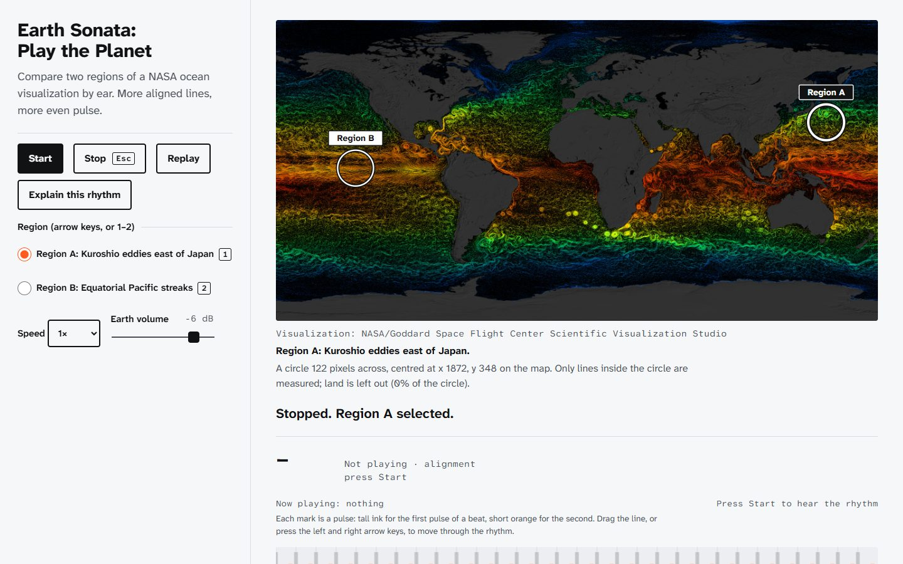
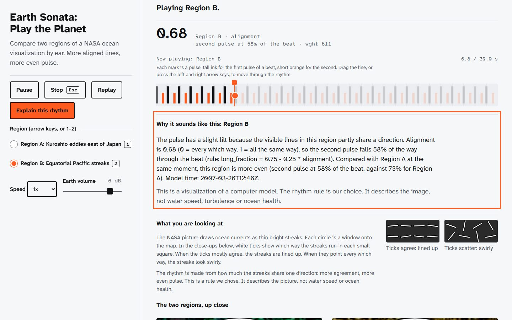
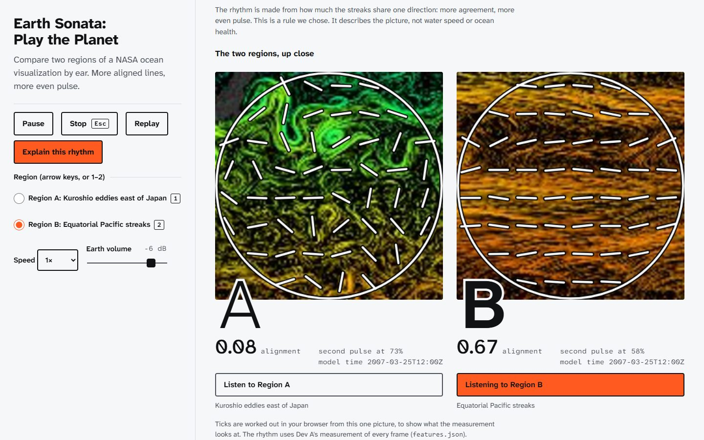

# First-time visitor instructions

Status: draft (Student B, 14 Nov). For testers, Student C and the project page. Checked against
the app on `main` with real data; screenshots in `screenshots/`.

**Open:** <https://build-future-minds.github.io/The-Earth-Information-Jukebox/> in Chrome, Edge or
Firefox, with sound on. Nothing plays until you press Start.

## Four steps (keyboard or mouse)

1. **Start and listen.** Press `Tab` until you reach **Start**, then press `Enter`. You hear
   Region A, the Kuroshio eddies east of Japan: one beat a second, two pulses a beat. Its pulse is
   short–long.
2. **Compare.** Press `Tab` to reach the **Region** choice, then press `2` (or the down arrow) for
   Region B, streaks in the Equatorial Pacific. It carries on from the same moment, so you can hear
   the two a few seconds apart. Its pulse is more even. Press `1` to go back.
3. **Ask why.** Reach **Explain this rhythm** and press `Enter`. It says how lined up the lines in
   the region are, where the second pulse falls, and how the region compares with the other one
   at the same moment.
4. **Stop.** Press `Esc` from anywhere. **Replay** starts the rhythm again from the beginning.

## Also on the page

- **Speed** (0.5× to 1.25×) and **Earth volume**, next to Start.
- **The two regions, up close:** each circle enlarged, with white ticks showing which way the lines
  run, and a **Listen** button for each region.
- **Both rhythms, one time line**, and **Add a melody (optional)**: `Tab` to the melody keys and play
  `A S D F G H J K` over the rhythm.
- **Practice: test your ear** opens Student B's listening game, a separate practice tool with its
  own sound settings, not the app's rule.

## Good to know

- It is a visualization of a computer model (ECCO2), not a photo. The rhythm rule is our choice.
  It describes the picture, not water speed, turbulence or ocean health.
- With a screen reader, the status line announces playing, paused and stopped, and focus moves to
  the explanation when it opens.
- The page needs an internet connection the first time it loads.
